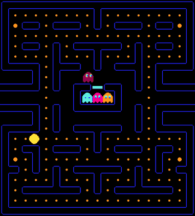

# Reinforced Pacman

This project is my attempt to make and train a deep-q network to play the original Pacman game. For reward flexibility and playing with different reward function, I decided to make the game itself from scratch.
I've experimented with various neural network architectures and data processing to get a beter understanding of tuning hyper parameters for training and preprocessing. These are all to be found below and appended to.

<p align="center">
  
  <br>
  <em>The trained DQN agent clearing the level (greedy policy, real-time speed). Score 2740.</em>
</p>

# Game Engine
For designing the game I decided to use the Simple and Fast Multimedia (SFML) library in c++. It is then integrated into python through building an API using pybind11. Only methods that are directly relevant to model training have been exported. These can be found in [binding.cpp](ui/bindings.cpp).


### Score Heurisitc:
Here I will outline how the score in the game works:
- Score is initalized at zero.
- Eating small pellets increases the score by 10. Large Pellets by 20.
- Eating large pellets places ghosts into frightened mode. Eating frightened ghosts increases the score by 200.
- The agent must eat all pellets to win the game.


### Ghost behavior:
Ghosts start in the ghost house with Blinky and Pinky awake at initalizaiton. Inky and Clyde are freed after Pacman has consumed 30 and 60 pellets, respectively. The only restriction in the ghosts movement is that they are unable to turn around. Here is a picture for ghost name reference:


The game consists of 5 states with distinct ghost behaviours:
1. Chase: differs for each Ghost. Described in detail below
2. Scatter: Each ghost has its specified scatter corner which it goes to when in this state. It can be seen with game initalization with the behaviour of Blinky and Pinky.
3. Frightened: Frightened ghosts' speed decreases by half and they take corners randomly. Once they collide with pacman they are set to Eaten state.
4. Eaten: Ghosts in this state are 1.5x as fast as Chase ghosts. They move back to the ghost house to be released in chase mode.
5. Sleep: Such ghosts have not yet been set free of the ghost house door, and will be so once the agent has eaten enough pellels. 

Each Ghost has a target which it's actively persuing in chase state:
- Blinky's target is pacman himself.
- Pinky's target is four tiles infront of the direction pacman is facing.
- Inky's target is a linear combination of Blinky and Pacman's position.
- Clyde's target is pacman but he switches to a scatter corner once he is closer than 8 tiles to pacman

The state of the game itself is set to have ghosts be in state chase for 20 seconds and scatter for 5, eating a power pellet restarts this condition. For a more detailed description of the rules, check [this](https://gameinternals.com/understanding-pac-man-ghost-behavior) out.


# Model Design:
### DeepQ Networks:
Q-learning is a reinforcement learning algorithm that teaches an agent how to act in an environment by assigning values to each action it might take (Q-values). Traditionaly, this is done through creating a q-table which maps each game state and action to a specific q-value. Thus, when making a decision given a game state, the agent chooses the immediate acton whcih leads to the maximum accumulation of a sequence of q-values that is to be followed on the table. While this approach is satisfactory for a game which can be represented through simple states, it does not scale well to complex environments like pacman. Hence, introducing the neural networks. 

The Neural network is to act as a q-function for us, giving us key values for every action given a game state. We then pick the aciton which seems to have the highest Q-value, we see how the game contiues and save the game's next state to be used with the action and correspondig state, as well as the reward for backpropagation. For a more detatailed explanation for how we evaluate the loss, take a look at [here](https://www.turing.com/kb/how-are-neural-networks-used-in-deep-q-learning).

### Architecture
**Engine.** All game logic lives in a headless, deterministic, frame-stepped [`Simulator`](game/simulator.hpp) (no SFML). Timings are in frames, the RNG is seeded, and a decision is requested each time Pacman reaches a cell centre (the only points where he can turn). [`BatchSim`](game/sim_bindings.cpp) steps many games at once from Python (~100k+ decisions/s). The SFML [`Display`](ui/display.hpp) is only a renderer of a `Simulator`, so watching an agent shows exactly the game it trained on.

**Observation.** 8 binary 21x21 planes taken straight from the game state: walls, pellets, power pellets, Pacman, dangerous ghosts, the cell each dangerous ghost is moving into, frightened ghosts, the cell each frightened ghost is moving into. Plus 3 scalars: frightened time left, fraction of pellets left, chase/scatter mode. The "moving into" planes give ghost direction, so no LSTM or frame stack is needed.

**Network** ([`model/dqn.py`](model/dqn.py)). 4 conv layers (64 channels, last one stride 2) → 512 FC → dueling value/advantage heads. Q-values for moves into walls are masked out.

**Algorithm** ([`model/train_dqn.py`](model/train_dqn.py)). Double DQN, 3-step returns, 64 parallel games, a 520k-transition replay buffer on the GPU, 2 gradient steps (batch 256) per 64 decisions, hard target sync every 2000 updates, ε linearly 1.0→0.01 over 4M decisions, Adam 2.5e-4, Huber loss, bf16 autocast.

**Rewards** (×0.1). Pellet +1, power pellet +2, ghost +5, death −25, clearing the level +50, −0.1 per decision.

### Results
Greedy evaluation (no random moves) on 200 new random games at each checkpoint, from the current 30M-step training run:

| Training decisions | Mean score | Level cleared |
|---|---|---|
| 1M | 929 | 0% |
| 3M | 1938 | 0% |
| 4.5M | 2015 | 10.5% |
| 7.5M | 2210 | 13.0% |
| 9.5M | 2213 | 25.0% |
| 11.5M | 2225 | 30.5% |

Maximum pellet score is 1520 (150 pellets); anything above that comes from eating frightened ghosts. Training runs at ~5.2k decisions/s on an RTX 5070, so 11.5M decisions is ~36 minutes.

The recording at the top of this page is a full game played by the 12.5M-step checkpoint and was generated with [`model/record.py`](model/record.py).

**Where it still fails.** In lost games the agent typically dies with 10–25 pellets left. It handles the crowded early and mid game well, but is caught chasing the last scattered pellets, when long trips across the maze give the ghosts time to close in.

## Set up
Requirements: CMake, a C++17 compiler, Python with `torch numpy matplotlib pybind11`, and SFML 2.5+ (only needed to play or watch; training is headless).
```bash
pip install pybind11 torch numpy matplotlib
./build.sh                      # builds build/pacman_sim*.so (headless) and build/pacman*.so + build/pacman_game (SFML)
```

Play it yourself (arrow keys):
```bash
cd model && python game.py      # or ./build/pacman_game
```

Train:
```bash
cd model && python train_dqn.py --run runs/dqn --steps 30000000
```
Writes `log.csv`, `progress.png`, `latest.pth` and `best.pth` (chosen by greedy-evaluation clear rate) into the run directory.

Evaluate headless / watch an agent play:
```bash
cd model && python evaluate.py runs/dqn/best.pth --episodes 1000
cd model && python watch.py runs/dqn/best.pth --games 3
```
